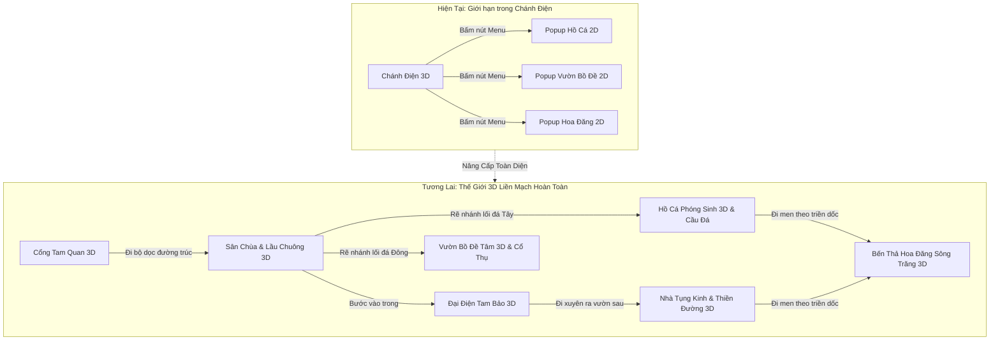
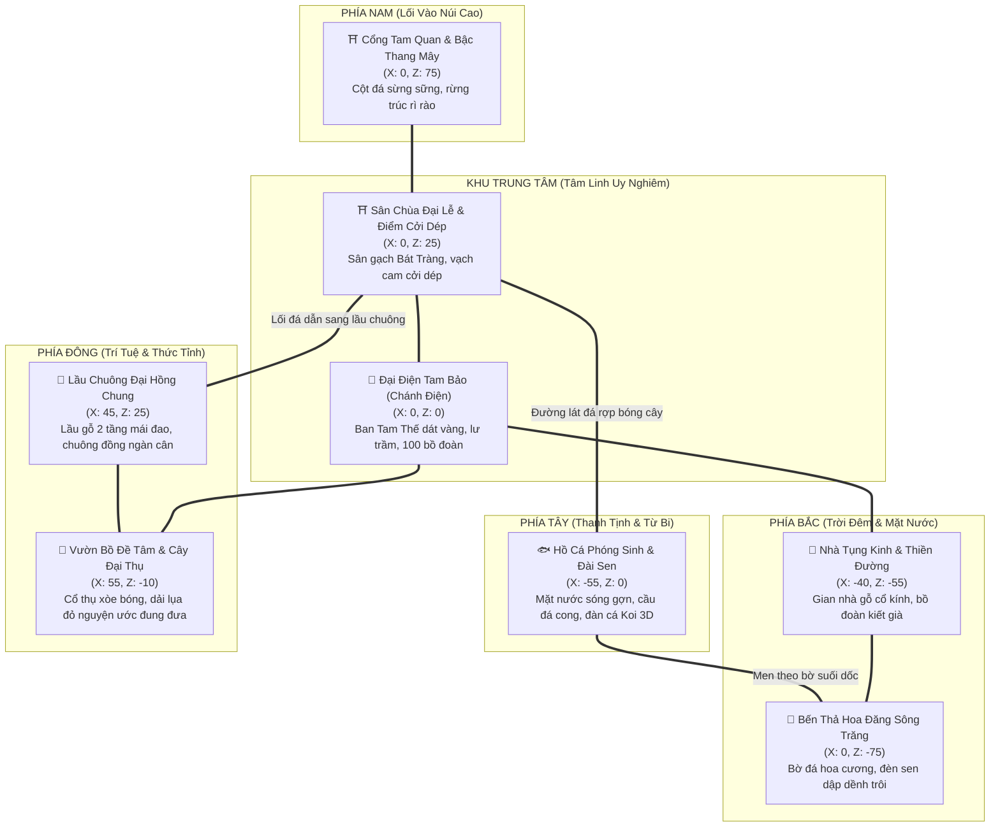
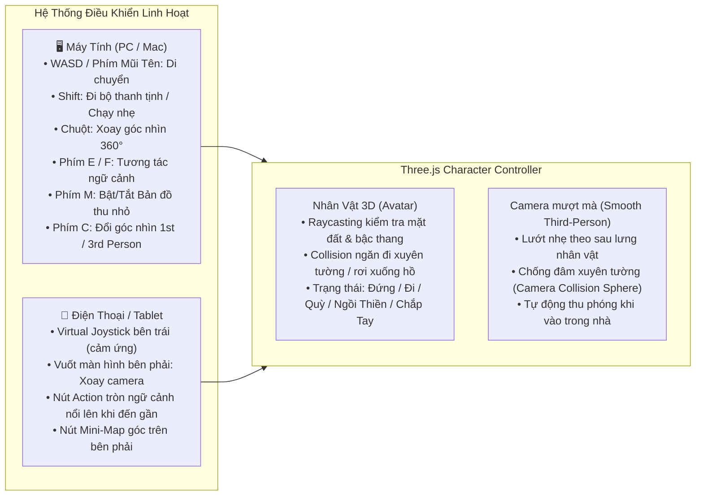
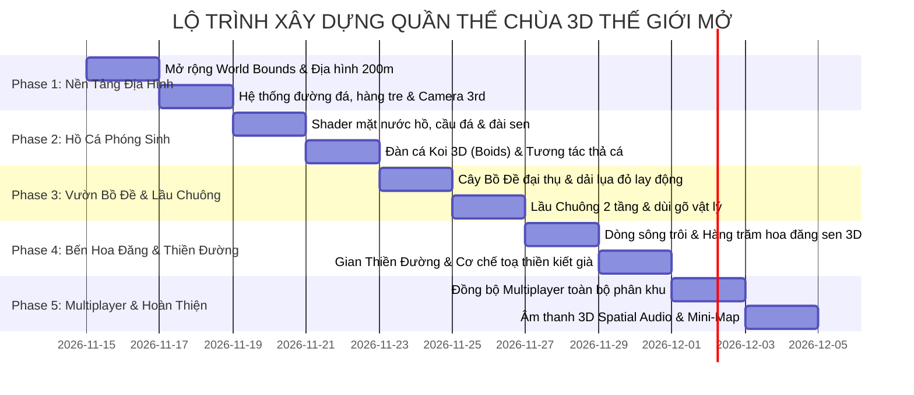

# 🏯 BẢN THIẾT KẾ KIẾN TRÚC & LỘ TRÌNH PHÁT TRIỂN
## QUẦN THỂ CHÙA 3D THẾ GIỚI MỞ LIỀN MẠCH (3D OPEN-WORLD SANCTUARY)
> **Dự án:** Đi Chùa Online · Chốn Thiền Môn Kỹ Thuật Số  
> **Mục tiêu:** Chuyển hóa toàn bộ trải nghiệm từ "xem các thẻ popup" sang **"Tự do nhập vai di chuyển trong thế giới 3D liền mạch giống game Open-World RPG"**.

---

## 1. TẦM NHÌN & ĐỊNH HƯỚNG TRẢI NGHIỆM (GAME DESIGN PARADIGM)

### Nguyên tắc thiết kế cốt lõi:
1. **Không Màn Hình Tải Phụ (Zero Loading Screen):** Toàn bộ khuôn viên chùa (Chánh Điện, Hồ Cá, Vườn Bồ Đề, Bến Sông, Lầu Chuông, Thiền Đường) nằm chung trên một bản đồ 3D duy nhất. Người chơi đi bộ hoặc chạy từ khu này sang khu khác mượt mà không bị ngắt quãng.
2. **Tương Tác Trực Tiếp Trong Không Gian 3D (In-World Interactions):** Thay vì mở popup che kín màn hình, nhân vật bước lại gần đối tượng (Lư hương, Quả chuông, Hồ cá, Cây Bồ Đề, Bến nước), bấm phím tương tác $\rightarrow$ nhân vật thực hiện động tác trực tiếp (quỳ lạy, thắp hương, rắc mồi, gõ chuông, thả đèn).
3. **Hiệu Năng Cực Cao (Ultra Lightweight Procedural 3D):** Giữ nguyên triết lý Three.js Procedural hình học tối ưu — không dùng file `.gltf` nặng nề, tải ngay trong 1-2 giây trên mạng 4G điện thoại, giữ vững 60 FPS.
4. **Cộng Đồng Đa Người Chơi Sống Động (Living Multiplayer):** Người chơi thấy nhau đi lại, trò chuyện bằng bong bóng chat trên đầu, cùng ngồi thiền, cùng thả đèn ven sông theo thời gian thực (Supabase Realtime).

---

## 2. QUY HOẠCH BẢN ĐỒ KHÔNG GIAN 3D (WORLD SPATIAL LAYOUT)

Bản đồ được mở rộng từ kích thước cũ `60m x 60m` lên **`200m x 200m`**, chia thành các phân khu phong cảnh gắn kết tự nhiên bằng các lối đi lát đá cuội, hàng tre xanh và cầu gỗ:

---

## 3. CHI TIẾT TỪNG PHÂN KHU 3D & CƠ CHẾ TƯƠNG TÁC (GAMEPLAY)

### 3.1. 🐟 Hồ Cá Phóng Sinh & Cầu Đá Đài Sen (Phía Tây Chùa)
* **Kiến trúc 3D:**
  * Lòng hồ hình oval tự nhiên lát đá cuội, mặt nước shader có độ trong suốt và sóng lăn tăn nhẹ.
  * Cầu đá cong bắc ngang hồ có lan can trạm hoa sen.
  * Đài sen đá phun nước nhẹ tạo bọt sủi tự nhiên.
* **Cơ chế Game & Tương tác:**
  * **Đàn cá Koi 3D:** Sử dụng thuật toán Flocking (Boids) giúp 15-20 chú cá Koi (đỏ, vàng kim, trắng đốm đen) bơi lội mềm mại, né chân cầu và tụ lại khi có người rắc mồi.
  * **Tương tác 1: Rắc mồi cho cá:** Nhân vật đứng trên cầu bấm phím `E` $\rightarrow$ hạt thức ăn rơi xuống nước, đàn cá bơi ùa lại đớp mồi tạo hiệu ứng bọt nước.
  * **Tương tác 2: Phóng sinh cá:** Mở giỏ phóng sinh, chọn loại cá và lời chúc $\rightarrow$ nhân vật nghiêng tay thả chú cá bơi tung tăng vào lòng hồ, đồng thời đồng bộ lưu vào Supabase (`pond_fish`).

---

### 3.2. 🌳 Vườn Bồ Đề Tâm & Cổ Thụ Nguyện Ước (Phía Đông Chùa)
* **Kiến trúc 3D:**
  * Cây Bồ Đề đại thụ dựng bằng Three.js với thân cây sần sùi cổ kính, rễ nổi gồ ghề trên gò đất cao.
  * Tán lá rộng lớn tỏa bóng mát, lác đác vài chiếc lá vàng rơi bay theo gió.
  * Hàng chục **dải lụa đỏ và vàng** treo lủng lẳng từ các nhánh cây, đung đưa theo thuật toán dao động gió (sinusoidal wind wave).
* **Cơ chế Game & Tương tác:**
  * **Tương tác 1: Tưới nước Bồ Đề:** Nhân vật cầm gáo nước tưới vào gốc cây $\rightarrow$ rễ cây phát sáng nhẹ, cây lớn thêm một bậc (giai đoạn nảy mầm $\rightarrow$ cây non $\rightarrow$ đại thụ).
  * **Tương tác 2: Treo Dải Lụa Nguyện Ước:** Viết lời nguyện $\rightarrow$ một dải lụa mới xuất hiện trên cành cây với tên của người chơi, người chơi khác đi lại gần có thể đọc được lời chúc đó!

---

### 3.3. 🪷 Bến Thả Hoa Đăng Sông Trăng (Phía Sau Chùa)
* **Kiến trúc 3D:**
  * Bờ đá hoa cương thoai thoải bước xuống mặt nước sông đêm phẳng lặng.
  * Bầu trời sao và trăng tròn phản chiếu lấp lánh trên dòng nước.
  * Hàng trăm chiếc hoa đăng sen phát ánh sáng vàng ấm và cánh hồng trôi lững lờ xuôi dòng từ bến ra xa vô tận.
* **Cơ chế Game & Tương tác:**
  * **Tương tác: Thả Đăng:** Nhân vật bước xuống bậc đá mép nước, bấm `E` $\rightarrow$ nhân vật ngồi thụp xuống, thắp ngọn nến đài sen và nhẹ nhàng đẩy ra mặt nước.
  * Chiếc hoa đăng mang tên và lời nguyện của bạn từ từ trôi nhập vào dòng hoa đăng của các phật tử khác trên khắp thế giới (đồng bộ qua Supabase `river_lanterns`).

---

### 3.4. 🔔 Lầu Chuông Đại Hồng Chung (Góc Đông Nam)
* **Kiến trúc 3D:**
  * Lầu vọng cảnh bằng gỗ 2 tầng mái đao cong vút, 4 cột gỗ lim uy nghi.
  * Quả đại hồng chung bằng đồng cổ kính khổng lồ treo ở trung tâm lầu chuông.
  * Dùi gỗ lim treo bằng dây thừng đỏ nằm ngang sẵn sàng điểm chuông.
* **Cơ chế Game & Tương tác:**
  * **Tương tác: Thỉnh Chuông:** Nhân vật lại gần kéo dùi gỗ $\rightarrow$ dùi đung đưa va chạm vật lý vào chuông $\rightarrow$ chuông rung lắc nhẹ $\rightarrow$ tiếng chuông đồng ngân vang trầm ấm tỏa ra xung quanh kèm vòng sóng âm phát quang (visual shockwave).

---

### 3.5. 🧘 Nhà Tụng Kinh & Thiền Đường (Phía Tây Bắc)
* **Kiến trúc 3D:**
  * Gian nhà ba gian bằng gỗ mái ngói vảy cá, cửa võng chạm trổ, mùi trầm thoang thoảng.
  * Các hàng bồ đoàn (đệm ngồi thiền màu mận chín) xếp thẳng tắp.
  * Bàn kinh điển có chuông mõ gia trì và mõ gỗ hình cá.
* **Cơ chế Game & Tương tác:**
  * **Tương tác 1: Toạ Thiền:** Bước lên bồ đoàn, bấm `E` $\rightarrow$ nhân vật tự động ngồi kiết già, camera chuyển sang góc quay điện ảnh êm đềm (Cinematic Orbit Cam), nhạc ngũ cung hoặc tiếng suối vang lên, đồng hồ đếm phút thiền định bắt đầu tính streak.
  * **Tương tác 2: Gõ Mõ Niệm Phật:** Bấm chuột / nút gõ $\rightarrow$ tiếng mõ "Cốc... Cốc... Cốc" vang lên, tràng hạt lần từng hạt theo nhịp gõ.

---

## 4. HỆ THỐNG ĐIỀU KHIỂN & CAMERA NÂNG CẤP (CONTROLS & CAMERA)

---

## 5. HỆ THỐNG ÂM THANH KHÔNG GIAN 3D (SPATIAL AUDIO ZONES)

Âm thanh được tính toán theo tọa độ khoảng cách của nhân vật $(x, y, z)$:
* **Khi ở gần Bến Sông:** Tiếng nước chảy róc rách và tiếng chuông gió ven sông lớn dần.
* **Khi vào Chánh Điện:** Tiếng tụng kinh Trầm ấm, tiếng chuông đồng gia trì ngân vang có độ vang vọng nhà kín (reverb).
* **Khi qua Vườn Bồ Đề:** Tiếng chim hót líu lo, tiếng lá xào xạc theo làn gió thoảng.
* **Khi đứng gần Tháp Chuông:** Tiếng chuông đồng vang dội rõ rệt từng âm bồi trầm.

---

## 6. LỘ TRÌNH TRIỂN KHAI THEO 5 GIAI ĐOẠN (PHASED ROADMAP)

### Chi tiết các Phase công việc:

#### 📌 Phase 1: Mở rộng địa hình & Hệ thống điều khiển tự do (ĐÃ HOÀN THÀNH ✅)
* [x] Mở rộng không gian `app/three/world.ts` từ `bounds` hẹp thành khuôn viên rộng lớn `200m x 200m` (`bounds: X[-88, 88], Z[-94, 62]`).
* [x] Kiến tạo các lối đi lát đá kết nối từ Chánh Điện sang cánh Tây (Lối sang Hồ Cá) và cánh Đông (Lối sang Vườn Bồ Đề & Lầu Chuông), lối ra Bến Hoa Đăng phía sau.
* [x] Trồng các rặng trúc xanh đu đưa theo gió, thảm cao nguyên đồi cỏ, hệ thống Thạch Đăng cổ kính ban đêm phát quang vàng ấm, biển chỉ dẫn thư pháp và ghế đá thiền tịnh.
* [x] Nâng cấp Controller: Hỗ trợ chạy nhanh Zen Sprint bằng phím `Shift` (PC) hoặc nút `🏃 Chạy / 🚶 Đi` (Mobile), cuộn chuột thu phóng 360° tự do, đa điểm Multi-touch cảm ứng trên di động siêu mượt, nhận diện phân khu (Zone Badge HUD).

#### 📌 Phase 2: Xây dựng Hồ Cá Phóng Sinh 3D & Cầu Đá Đài Sen (ĐÃ HOÀN THÀNH ✅)
* [x] Tạo mô hình lòng hồ nước ngọc bích sâu 3m, bờ kè đá cuội quanh hồ, shader mặt nước chuyển động sóng dập dềnh phản chiếu, đài sen đá phun nước giữa hồ với hiệu ứng bọt nước sủi bọt và 4 cụm hoa sen hồng nở rộ bồng bềnh trên lá sen ngọc bích.
* [x] Dựng cầu đá vòm cong (Arched Stone Bridge) dài 24.5m vắt ngang qua hồ từ bờ Đông sang bờ Tây, lan can đá với chóp búp sen, vật lý bậc cầu cong nâng hạ độ cao nhân vật mượt mà theo dáng vòm Parabol khi sải bước qua hồ, ngăn nhân vật rớt xuống nước.
* [x] Mô hình đàn cá Koi 3D khớp chuyển động (khớp đuôi uốn lượn, vây bơi, mắt) với 5 biến thể màu sắc (Kohaku đỏ trắng, Taisho Sanke tam thể, Yamabuki Ogon hoàng kim, Cá chép đỏ cam, Showa đen đỏ).
* [x] Thuật toán bầy đàn (Boids Flocking Simulation) đa tầng: bơi tuần tra ngẫu nhiên, uốn lượn theo nhịp sin, tránh bờ hồ đá cuội và tránh va chạm trụ đài sen.
* [x] Cơ chế Rắc Mồi (`fish_feed`): Thả các viên thức ăn vàng óng rơi xuống nước tạo vòng sóng lan tỏa (Water Ripples), đàn cá ngửi thấy mùi lập tức bơi nhanh về phía thức ăn và nổi lên đớp mồi, tăng lượt cho ăn và cộng công đức tu tập.
* [x] Cơ chế Phóng Sinh Cá Cát Tường (`fish_release`): Bến gỗ phóng sinh bên bờ hồ, modal chọn loài cá, đặt tên chú cá, gửi gắm lời chúc nguyện, sinh ngay chú cá 3D bơi lội trong hồ và lưu vĩnh viễn vào Supabase table `pond_fish` cùng bộ nhớ máy.

#### 📌 Phase 3: Xây dựng Vườn Bồ Đề Tâm 3D & Lầu Chuông Đại Hồng Chung
* [ ] Dựng cây Bồ Đề đại thụ tán xòe bóng mát, rễ nổi và hệ thống dải lụa đỏ lay động theo gió.
* [ ] Dựng Lầu Chuông 2 tầng mái đao cổ kính bằng gỗ, chuông đồng lớn và dùi gỗ gõ chuông.
* [ ] Tương tác: Treo dải lụa nguyện ước (lưu Supabase) & Kéo dùi gõ Đại Hồng Chung ngân vang.

#### 📌 Phase 4: Xây dựng Bến Thả Hoa Đăng Sông Trăng & Thiền Đường 3D
* [ ] Tạo dòng sông đêm phản chiếu ánh trăng, bờ đá hoa cương dẫn xuống mép nước.
* [ ] Hàng trăm hoa đăng hoa sen phát sáng dập dềnh trôi xuôi dòng nước.
* [ ] Dựng gian Nhà Tụng Kinh & Thiền Đường với các hàng bồ đoàn, mõ gỗ, chuông bát.
* [ ] Tương tác: Thả hoa đăng trôi theo dòng nước & Ngồi kiết già toạ thiền nhập định.

#### 📌 Phase 5: Tối ưu Multiplayer, Spatial Audio & Mini-Map HUD
* [ ] Đồng bộ hóa vị trí của mọi người chơi trên toàn bộ bản đồ 200m qua Supabase Realtime Broadcast.
* [ ] Thêm Mini-Map radar nhỏ ở góc màn hình hiển thị vị trí bản thân và các phật tử khác.
* [ ] Hệ thống âm thanh 3D Spatial Audio: lại gần nơi nào thì âm thanh đặc trưng của nơi đó vang lên chân thực.

---

> [!TIP]
> Bản kế hoạch trên đảm bảo trang web của bạn nâng cấp lên chuẩn **Game 3D Metaverse Thiền Môn** hiện đại bậc nhất, trong khi vẫn giữ dung lượng siêu nhẹ, mượt mà trên mọi thiết bị và giữ trọn vẹn sự trang nghiêm thanh tịnh.

