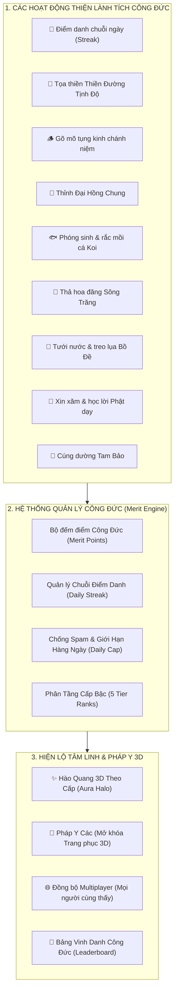
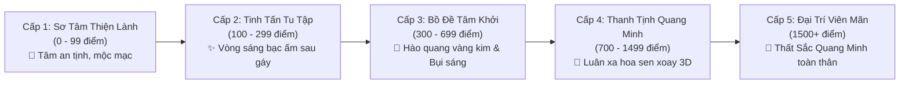

# 🪷 BẢN THIẾT KẾ KIẾN TRÚC & LỘ TRÌNH PHÁT TRIỂN
## HỆ THỐNG CÔNG ĐỨC TU HỌC · HÀO QUANG 3D · PHÁP Y CÁC
> **Dự án:** Đi Chùa Online · Chốn Thiền Môn Kỹ Thuật Số  
> **Mục tiêu:** Xây dựng hệ sinh thái Gamification Thiền Môn chân chính, tôn vinh nỗ lực tu tập hàng ngày của phật tử qua cơ chế **Tích lũy Công đức**, hiển lộ **Hào quang 3D** tương ứng cấp bậc, và quy đổi **Pháp phục trang nghiêm** cho nhân vật 3D.

---

## 1. TỔNG QUAN KIẾN TRÚC & TRIẾT LÝ THIẾT KẾ



### Triết lý cốt lõi:
1. **Tu học không gượng ép, hướng thiện tự nhiên:** Điểm công đức không phải là tiền tệ mua bán, mà là sự ghi nhận hành trình tinh tấn hàng ngày (Mindfulness & Merit).
2. **Trang nghiêm, thanh tịnh, tôn trọng văn hóa Phật giáo:** Trang phục và hào quang được thiết kế đúng tinh thần nhà Phật (áo lam cư sĩ, áo nâu sồng, bạch y tuyết liên, cà sa thanh thoát; hào quang ấm áp, trang trọng, không lòe loẹt như game kiếm hiệp).
3. **Hiệu năng Three.js 60 FPS mượt mà:** Hiệu ứng hào quang và trang phục được tính toán tối ưu bằng Three.js Mesh Procedural và Sprite phát quang nhẹ, chạy mượt trên mọi thiết bị di động.
4. **Kết nối cộng đồng thời gian thực (Living Sangha):** Người chơi khác khi gặp bạn trong sân chùa 3D sẽ nhìn thấy ngay trang phục bạn đang mặc và quầng hào quang tỏa sáng trên đầu bạn.

---

## 2. QUY CHUẨN ĐIỂM CÔNG ĐỨC & CƠ CHẾ CHỐNG SPAM

### A. Bảng phân bổ điểm công đức:

| STT | Hoạt động thiện lành | Điểm công đức | Tần suất & Giới hạn tối đa |
|:---:|:---|:---:|:---|
| 1 | **Điểm danh đầu ngày (Daily Check-in)** | **+20** | 1 lần / ngày. <br/>• Chuỗi 3 ngày: **+10** thưởng thêm<br/>• Chuỗi 7 ngày: **+30** thưởng thêm<br/>• Chuỗi 14 ngày: **+60** thưởng thêm<br/>• Chuỗi 30 ngày: **+150** thưởng thêm |
| 2 | **Tọa thiền tại Thiền Đường Tịnh Độ** | **+10** | Cứ mỗi 3 phút tĩnh tâm tọa thiền (Tối đa 30 điểm / ngày) |
| 3 | **Phóng sinh cá Koi vào hồ** | **+15** | Mỗi lần thả cá phóng sinh (Tối đa 3 lần / ngày) |
| 4 | **Thả hoa đăng cầu an Sông Trăng** | **+15** | Mỗi lần thả hoa đăng viết nguyện ước (Tối đa 3 lần / ngày) |
| 5 | **Tưới nước Cam Lộ Cội Bồ Đề** | **+10** | 1 lần / ngày |
| 6 | **Treo dải lụa nguyện ước Bồ Đề** | **+10** | 1 lần / ngày |
| 7 | **Thỉnh Đại Hồng Chung ngân vang** | **+5** | Cooldown 30s giữa các lần (Tối đa 3 lần / ngày = 15 điểm) |
| 8 | **Gõ mõ tụng kinh chánh niệm** | **+5** | Mỗi chuỗi 21 hồi mõ chuông (Tối đa 3 chuỗi / ngày = 15 điểm) |
| 9 | **Rắc mồi cho đàn cá Koi** | **+3** | Cooldown 15s (Tối đa 3 lần / ngày = 9 điểm) |
| 10 | **Xin xăm & Đọc lời Phật dạy** | **+5** | 1 lần / ngày |
| 11 | **Cúng dường Tam Bảo (Hỷ cúng)** | **+10 ~ +100** | Tùy tâm đóng góp vào quỹ tu bổ chùa |

> [!IMPORTANT]
> **Cơ chế Chống Spam (Anti-Spam & Daily Cap):**
> - Tổng điểm tối đa từ các hoạt động cơ học (không tính cúng dường và thưởng streak) là **120 điểm / ngày**.
> - Đảm bảo phật tử duy trì thói quen ghé chùa mỗi ngày trong chánh niệm, không bị biến thành cày cuốc cơ học.

---

## 3. HỆ THỐNG 5 CẤP BẬC CÔNG ĐỨC & HÀO QUANG 3D (3D AURA HALO)

Khi tích lũy điểm công đức, avatar người chơi sẽ tự động khai mở các tầng hào quang quang minh:



### Chi tiết tạo hình 3D cho từng cấp bậc:

1. **Cấp 1 – Sơ Tâm Thiện Lành (0 – 99 điểm):**
   * *Ý nghĩa:* Bước chân đầu tiên vào cửa Phật, tâm niệm hướng thiện, chất phác.
   * *Hiệu ứng 3D:* Không có hào quang. Áo lam cư sĩ mộc mạc.

2. **Cấp 2 – Tinh Tấn Tu Tập (100 – 299 điểm):**
   * *Ý nghĩa:* Phật tử cần cù siêng năng, ngày ngày tụng kinh niệm Phật, giữ gìn ngũ giới.
   * *Hiệu ứng 3D:* Một vòng hào quang ánh bạc ấm áp (`Soft Silver-White Halo`) bán kính $0.38\text{m}$ lơ lửng phía sau gáy nhân vật, nhịp thở phát quang êm dịu (`breathing opacity: 0.5 ~ 0.85`).

3. **Cấp 3 – Bồ Đề Tâm Khởi (300 – 699 điểm):**
   * *Ý nghĩa:* Khởi phát tâm đại bi, phóng sinh cứu vật, nguyện đem công đức hồi hướng muôn loài.
   * *Hiệu ứng 3D:* Vòng hào quang vàng kim rực rỡ (`Golden Radiance Halo`) với 2 tầng ánh sáng; xung quanh đầu nhân vật lấp lánh 8 đốm bụi sáng nhỏ (`sparkle particles`) bay lượn quỹ đạo tròn êm ái.

4. **Cấp 4 – Thanh Tịnh Quang Minh (700 – 1499 điểm):**
   * *Ý nghĩa:* Thân tâm thanh tịnh, đoạn trừ phiền não, trí tuệ quang minh khai mở.
   * *Hiệu ứng 3D:* Vòng hào quang hoa văn **Đài Sen 12 cánh** xoay chậm 3D (`Rotating Lotus Lightwheel`) sau đầu, kết hợp vòng sáng nhẹ tỏa rạng quanh mặt đất dưới chân khi bước đi.

5. **Cấp 5 – Đại Trí Viên Mãn (1500+ điểm):**
   * *Ý nghĩa:* Bậc đại thiện tri thức tinh tấn viên mãn, công đức vô lượng.
   * *Hiệu ứng 3D:* **Hào quang Thất Sắc Quang Minh (Rainbow Celestial Aura)** tỏa 7 luồng ánh sáng nhiệm màu; mỗi bước chân di chuyển nở ra một đóa sen phát sáng mờ ảo dưới gót chân (`lotus footstep particle`).

---

## 4. "PHÁP Y CÁC" – CỬA HÀNG QUY ĐỔI PHÁP PHỤC TRANG NGHIÊM

Người chơi dùng điểm công đức tích lũy để quy đổi (mở khóa vĩnh viễn) các bộ pháp phục và phụ kiện thiền môn:

| Mã | Tên Pháp Phục | Công đức cần đổi | Mô tả hình ảnh 3D & Phối màu |
|:---:|:---|:---:|:---|
| `robe_lam` | **Áo Lam Cư Sĩ** | **0 (Mặc định)** | Vải lam xám mộc mạc (`#5f6f82`), vạt áo thanh nhã của cư sĩ tại gia. |
| `robe_nau` | **Áo Nâu Sồng Thiền Tịnh** | **120 điểm** | Màu nâu sồng đất ấm (`#5c3d28`), biểu trưng cho tinh thần nhẫn nhục, giản dị của người tu sĩ. |
| `robe_chivang` | **Áo Tràng Lam Viền Chỉ Vàng** | **300 điểm** | Áo tràng lam đậm (`#3f526b`), viền cổ áo và vạt áo thêu họa tiết chỉ vàng óng ánh (`#e2b744`). |
| `robe_bach_y` | **Bạch Y Tuyết Liên** | **600 điểm** | Bộ bạch y trắng tinh khôi (`#f2f5f7`), vạt áo nhẹ nhàng thoát tục như đóa sen tuyết. |
| `robe_ca_sa` | **Pháp Y Cà Sa Gấm Vàng** | **1200 điểm** | Khoác áo cà sa gấm vàng hổ phách (`#d49924`) chéo vai, thêu hoa văn pháp luân cao quý uy nghiêm. |
| `acc_trang_hat` | **Chuỗi Tràng Hạt Bồ Đề 108 hạt** | **200 điểm (Phụ kiện)** | Chuỗi hạt bồ đề màu gỗ mun quấn vòng quanh cổ nhân vật. |
| `acc_non_la` | **Nón Lá Trúc Thiền Môn** | **150 điểm (Phụ kiện)** | Nón lá chuốt thanh thoát đội nhẹ trên đầu nhân vật che nắng sớm. |

---

## 5. LỘ TRÌNH TRIỂN KHAI CHI TIẾT (5 PHASES)

### PHASE 1: NỀN TẢNG DỮ LIỆU & BỘ MÁY CÔNG ĐỨC (MERIT ENGINE)
> **Mục tiêu:** Xây dựng module quản lý điểm công đức, chuỗi điểm danh và tích hợp cơ chế cộng điểm vào mọi hoạt động hiện có.
> **Trạng thái:** ✅ **ĐÃ HOÀN THÀNH TOÀN BỘ (100%)**

- [x] **Task 1.1: Tạo Composable `app/composables/useMeritSystem.ts`:**
  - Định nghĩa kiểu dữ liệu `MeritProfile`: `totalMerit`, `currentTier`, `streakDays`, `lastCheckInDate`, `todayPoints`, `unlockedOutfits`, `currentOutfit`, `history`.
  - Logic cộng điểm `earnMerit(action, amount, description)`.
  - Kiểm tra mức trần chống spam theo ngày (`dailyCap = 120`).
  - Hỗ trợ lưu trữ bền vững tại `localStorage` và tự động đồng bộ lên Supabase nếu có đăng nhập.
- [x] **Task 1.2: Tích hợp trigger cộng điểm vào các hành vi 3D:**
  - Gõ chuông Chánh Điện & Lầu Chuông: `earnMerit('bell_ring', 5, 'Thỉnh Đại Hồng Chung')`.
  - Rắc mồi cho cá Koi: `earnMerit('fish_feed', 3, 'Rắc mồi cho cá')`.
  - Phóng sinh cá Koi: `earnMerit('fish_release', 15, 'Phóng sinh cá Koi')`.
  - Thả hoa đăng Sông Trăng: `earnMerit('lantern_release', 15, 'Thả hoa đăng cầu an')`.
  - Tưới nước cội Bồ Đề: `earnMerit('bodhi_water', 10, 'Tưới nước Bồ Đề')`.
  - Treo lụa ước nguyện: `earnMerit('bodhi_ribbon', 10, 'Treo lụa Bồ Đề')`.
  - Gõ mõ tụng kinh: `earnMerit('wooden_fish', 5, 'Gõ mõ chánh niệm')`.
  - Tọa thiền kiết già: tính theo timer (mỗi 1 phút / 3 phút cộng 10 điểm).
  - Thắp hương, cúng dường, đọc kinh: tích hợp trigger công đức toàn diện.
- [x] **Task 1.3: Hiệu ứng Toast thông báo công đức & thăng cấp:**
  - Toast mạ vàng kèm âm thanh chuông thanh thoát (`playMeritChime` Solfeggio 528Hz) mỗi khi nhận công đức.
  - Hộp thông báo đặc biệt khi thăng cấp tâm linh (`MeritLevelUpModal.vue`) khai mở chi tiết Hào quang 3D tương ứng.
  - Nút HUD Sổ Công Đức (`MeritProfileModal.vue`) hiển thị trực quan huy hiệu cấp bậc, chuỗi streak và tiến trình điểm ngày.

---

### PHASE 2: SỔ ĐIỂM DANH TINH TẤN & CHUỖI STREAK (DAILY CHECK-IN)
> **Mục tiêu:** Xây dựng tính năng điểm danh hàng ngày, thúc đẩy người dùng ghé thăm chùa mỗi ngày.
> **Trạng thái:** ✅ **ĐÃ HOÀN THÀNH TOÀN BỘ (100%)**

- [x] **Task 2.1: Logic điểm danh và duy trì chuỗi (Streak Engine):**
  - So sánh ngày hiện tại với `lastCheckInDate`.
  - Nếu là ngày tiếp theo: `streakDays++`. Nếu bị ngắt quãng quá 1 ngày: reset về 1.
  - Tính thưởng thêm điểm công đức ở các cột mốc: 3 ngày (+10đ), 7 ngày (+30đ), 14 ngày (+60đ), 30 ngày (+150đ), và các chu kỳ tiếp theo.
  - Tích hợp 7 lời chúc kinh Phật khai tâm ngẫu nhiên hàng ngày (`BUDDHIST_BLESSINGS`).
- [x] **Task 2.2: Giao diện Modal "Sổ Điểm Danh Tinh Tấn" (`CheckInModal.vue`):**
  - Thiết kế bảng lịch 7 ngày trong tuần với biểu tượng hoa sen nở theo từng ngày đã điểm danh.
  - Nút bấm *"Điểm Danh Đầu Ngày"* mạ vàng phát sáng trang nhã kèm âm thanh chuông thanh thoát.
  - Lời chúc cát tường ngẫu nhiên mỗi sáng kèm câu kinh Phật khai tâm.
- [x] **Task 2.3: Bổ sung Bảng Điểm Danh gỗ tại Sân Chùa Đại Lễ:**
  - Đặt một biển gỗ chạm khắc cổ kính tại sân chùa ($X: 18, Z: 20$) với nhãn `📅 Sổ Điểm Danh Tinh Tấn` (mái ngói cổ kính, lồng đèn đỏ đung đưa, án thư gỗ lim).
  - Người chơi bước lại gần bấm phím tương tác để mở giao diện điểm danh trực tiếp trong 3D.
  - Thêm vật lý va chạm (collider) tại $(X: 18, Z: 20)$ và hiển thị địa danh trên MiniMapRadar & TempleMapModal.

---

### PHASE 3: HIỆU ỨNG HÀO QUANG 3D THEO CẤP (3D AURA & HALO SYSTEM)
> **Mục tiêu:** Tạo dựng mô hình đồ họa 3D cho 5 tầng hào quang trong `TempleScene3D.client.vue`.
> **Trạng thái:** ✅ **ĐÃ HOÀN THÀNH TOÀN BỘ (100%)**

- [x] **Task 3.1: Dựng các khối hình học Hào quang (Three.js Halo Meshes):**
  - **Vòng hào quang bạc (Cấp 2):** `RingGeometry(0.32, 0.46, 36)` phát ánh sáng trắng ấm `0xf0f4f8`, gắn phía sau đầu avatar ($Y: 2.32\text{m}, Z: -0.16\text{m}$).
  - **Hào quang kim sắc & Hạt bụi sáng (Cấp 3):** Vòng hào quang kép vàng kim `0xffd54f` & `0xfff176`, kèm 8 particle `SphereGeometry(0.025)` bay lượn quỹ đạo quanh đầu.
  - **Đài sen quang minh xoay (Cấp 4):** Vòng hào quang 12 cánh sen xoay 3D quanh trục $Z$ sau đầu, kết hợp quầng hào quang phát sáng dưới mặt đất quanh chân avatar.
  - **Thất sắc quang minh (Cấp 5):** Quầng sáng thất sắc rực rỡ luân chuyển chu kỳ màu nhiệm màu (`HSV Rainbow Cycle`), 2 luân xa sen xoay ngược chiều, 12 hạt tinh tú đa chiều, và hiệu ứng dấu chân hoa sen nở bừng rồi tan biến dưới từng bước đi.
- [x] **Task 3.2: Bộ cập nhật Animation trong `animate()` loop:**
  - Nhịp thở phát quang hình sin êm dịu (`breath = 0.65 + sin(t*2.2)*0.22`).
  - Xoay luân xa sen ở Cấp 4 và Cấp 5 theo tốc độ $\approx 0.42\text{ rad/s}$.
  - Hạt bụi sáng quay quanh đầu theo quỹ đạo sóng điều hòa $\cos(t), \sin(t)$.
  - Tự động spawn và làm mờ các đóa sen bước chân sau $1.6\text{s}$.
- [x] **Task 3.3: Tùy chọn Ẩn / Hiện Hào quang:**
  - Nút chuyển đổi nhanh `✨ Hào quang / Ẩn quang` trên thanh HUD góc trên và trong modal Sổ Công Đức, bật/tắt tức thì không cần reload.

---

### PHASE 4: PHÁP Y CÁC – QUY ĐỔI & THAY ĐỔI TRANG PHỤC 3D
> **Mục tiêu:** Tạo giao diện cửa hàng pháp phục và nâng cấp mô hình nhân vật 3D cho phép thay đổi y phục tức thì.
> **Trạng thái:** ✅ **ĐÃ HOÀN THÀNH TOÀN BỘ (100%)**

- [x] **Task 4.1: Nâng cấp hàm `buildAvatar` trong `TempleScene3D.client.vue`:**
  - Mở rộng tham số nhận `outfitId` (`robe_lam`, `robe_nau`, `robe_chivang`, `robe_bach_y`, `robe_ca_sa`) và phụ kiện (`acc_trang_hat`, `acc_non_la`).
  - Đổi màu sắc vải vóc, thêm dải áo cà sa vàng hổ phách khoác chéo vai kèm chốt cài pháp luân kim bảo, thêm chuỗi tràng hạt bồ đề 108 hạt rủ tua đỏ trước ngực, thêm nón lá nứa trúc thanh tao.
  - Hàm `setAvatarOutfit(outfitId, accessories)` cập nhật mô hình trực tiếp, mượt mà không reload thế giới 3D.
- [x] **Task 4.2: Thiết kế Modal "Pháp Y Các" (`OutfitShopModal.vue`):**
  - Giao diện phòng thử đồ pháp phục thiền môn cổ kính trang nhã với bộ lọc tab (Tất cả / Pháp phục / Phụ kiện).
  - Khung xem trước (Preview) màu sắc, ý nghĩa tâm linh đạo Phật và chi tiết tạo hình 3D.
  - Nút *"Quy Đổi"* (kèm âm thanh chuông bát nhã) hoặc *"Khoác Áo"* / *"Đeo Phụ Kiện"*.
- [x] **Task 4.3: Lưu trữ trang phục đã chọn:**
  - Lưu trữ bền vững vào `localStorage` và Supabase (`unlocked_outfits`, `current_outfit`, `active_accessories`).
  - Tự động tải lại trang phục và phụ kiện đã lưu khi vào chùa; thêm nút HUD `👘 Pháp Y` trên thanh điều hướng và liên kết trong Sổ Công Đức.

---

### PHASE 5: ĐỒNG BỘ MULTIPLAYER & BẢNG VINH DANH CÔNG ĐỨC
> **Mục tiêu:** Mọi người chơi khác trong thế giới 3D đều nhìn thấy hào quang và trang phục của nhau; xây dựng Bảng Vinh Danh Công Đức trang trọng.
> **Trạng thái:** ✅ **ĐÃ HOÀN THÀNH TOÀN BỘ (100%)**

- [x] **Task 5.1: Mở rộng gói tin Broadcast trong `useMultiplayer.ts`:**
  - Thêm các trường `auraTier` (1 đến 5), `showAura`, `outfitId` và `accessories` vào `LocalState` và `RemotePlayer`.
  - Cập nhật avatar từ xa (`RemoteAvatar`): khi người chơi khác bước vào phòng, tự động gán đúng màu áo, phụ kiện và tạo vòng hào quang tương ứng cấp bậc của họ. Tự động phản ứng khi người chơi khác đổi y phục hoặc thăng cấp hào quang.
- [x] **Task 5.2: Bảng Vàng Công Đức (Leaderboard Modal - `MeritLeaderboardModal.vue`):**
  - Giao diện tuyên dương trang nghiêm với bục vinh danh Top 3 (Quán quân 🥇, Hạng nhì 🥈, Hạng ba 🥉) và danh sách bảng xếp hạng đầy đủ từ hạng 4 trở đi.
  - Tab "Tấm Lòng Vàng Tu Bổ Chùa": Ghi nhận công quả trợ duyên (đúc chuông, trồng bồ đề, phóng sinh, thắp hoa đăng, cúng dường).
  - Tự động đồng bộ Supabase hoặc seed cộng đồng thiền môn, highlight rõ vị trí và thứ hạng của người chơi.
- [x] **Task 5.3: Kiểm thử toàn diện & Tối ưu hóa hiệu năng (QA & Polish):**
  - Tối ưu hóa FPS: Chỉ chạy animation hạt & luân xa chi tiết của người chơi khác khi ở trong phạm vi gần camera (< 50m).
  - Tự động dispose các đối tượng Three.js (mesh, halo, footsteps, particles) khi người chơi khác ngắt kết nối hoặc khi unmount scene.
  - Kiểm thử build thành công `npm run build` không có lỗi.

---

## 6. CẤU TRÚC DỮ LIỆU ĐỀ XUẤT (DATA SCHEMA)

### A. TypeScript Interface (`useMeritSystem.ts`):
```typescript
export interface MeritProfile {
  totalMerit: number           // Tổng điểm tích lũy trọn đời
  currentMerit: number         // Điểm khả dụng để quy đổi pháp phục
  currentTier: 1 | 2 | 3 | 4 | 5 // Cấp bậc hào quang hiện tại
  streakDays: number           // Chuỗi ngày điểm danh liên tục
  lastCheckInDate: string      // Ngày điểm danh gần nhất (YYYY-MM-DD)
  todayPoints: number          // Điểm đã nhận trong ngày hôm nay (Max 120)
  lastPointsResetDate: string  // Ngày reset điểm trần (YYYY-MM-DD)
  unlockedOutfits: string[]    // Danh sách mã trang phục đã sở hữu
  currentOutfit: string        // Trang phục đang mặc
  showAura: boolean            // Bật/tắt hiển thị hào quang
  history: MeritLogItem[]      // Nhật ký 20 lần nhận công đức gần nhất
}

export interface MeritLogItem {
  id: string
  action: string
  amount: number
  description: string
  timestamp: number
}
```

### B. Supabase Table (Tùy chọn khi người dùng đăng nhập):
```sql
CREATE TABLE IF NOT EXISTS user_merit_profiles (
  user_id UUID PRIMARY KEY REFERENCES auth.users(id) ON DELETE CASCADE,
  dharma_name TEXT,
  total_merit INTEGER DEFAULT 0,
  current_merit INTEGER DEFAULT 0,
  tier INTEGER DEFAULT 1,
  streak_days INTEGER DEFAULT 0,
  last_check_in DATE,
  unlocked_outfits TEXT[] DEFAULT ARRAY['robe_lam'],
  current_outfit TEXT DEFAULT 'robe_lam',
  updated_at TIMESTAMP WITH TIME ZONE DEFAULT NOW()
);
```

---

## 7. ĐÁNH GIÁ TÁC ĐỘNG & KẾT QUẢ MONG ĐỢI

1. **Gia tăng mạnh mẽ mức độ gắn bó (User Retention):** Phật tử có lý do rõ ràng và cảm hứng đẹp đẽ để quay trở lại viếng chùa mỗi sáng (điểm danh, gõ mõ, ngắm cá Koi, tích công đức).
2. **Không gian 3D rực rỡ và sống động hơn:** Buổi tối trong chùa, các phật tử đi lại với những vầng hào quang ấm áp, trang phục trang nghiêm lung linh dưới ánh trăng và đèn hoa đăng.
3. **Cộng đồng tu tập hướng thiện gắn kết:** Mọi người nhìn thấy sự tinh tấn của nhau, cùng nhau trợ duyên và sách tấn trên con đường tu học an lạc.

